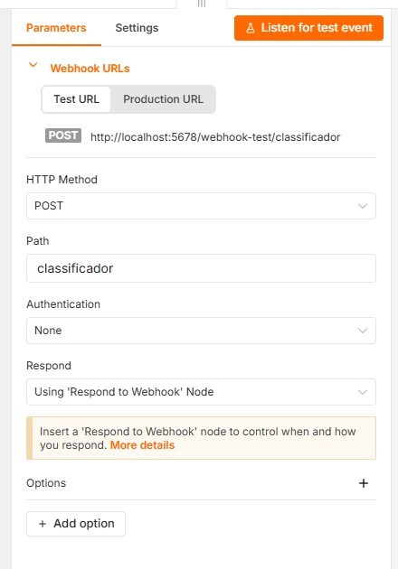
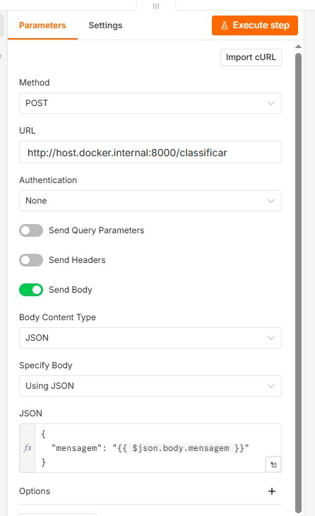
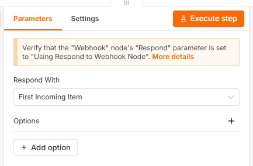

#  Classificador de Mensagens KODIE

Solução desenvolvida como parte do Desafio Técnico de IA e Automação da KODIE, que utiliza Inteligência Artificial para classificar automaticamente mensagens de clientes e automatizar o fluxo de encaminhamento com n8n.

---

## 1. Apresentação da Ideia

A ideia surgiu a partir do cenário proposto no desafio: pequenas empresas que recebem diariamente diversas mensagens de clientes e precisam de uma pessoa dedicada para ler, identificar o assunto e encaminhar manualmente para o setor responsável.

Esse processo manual consome tempo e gera desorganização. A proposta foi automatizar essa triagem utilizando IA para interpretar e classificar as mensagens, e o n8n para orquestrar o fluxo de automação.

---

## 2. Problema Escolhido

**Caso 4.1 — Classificação de Mensagens**

Uma empresa recebe mensagens de clientes com diferentes tipos de solicitações, mas não possui um processo organizado para identificar cada assunto. A solução analisa e classifica cada mensagem em uma das categorias: **dúvida**, **reclamação** ou **solicitação**.

---

## 3. Solução Proposta

A solução funciona da seguinte forma:

1. O n8n recebe a mensagem do cliente via **Webhook**
2. O fluxo repassa a mensagem para a **API FastAPI**
3. A API envia a mensagem ao modelo **Gemini** com um prompt estruturado
4. O Gemini retorna a classificação em **JSON** com categoria, nível de confiança e resumo
5. O n8n retorna o resultado para quem fez a requisição

A IA participa como motor de interpretação de linguagem natural, identificando a intenção da mensagem e classificando-a de forma estruturada, sem necessidade de regras manuais.

---

## 4. Tecnologias Utilizadas

| Tecnologia | Uso |
|---|---|
| Python 3 | Linguagem do backend |
| FastAPI | Framework da API REST |
| Uvicorn | Servidor ASGI |
| Google Gemini (`gemini-3.1-flash-lite`) | Modelo de IA para classificação |
| google-genai | SDK oficial do Google para IA |
| python-dotenv | Gerenciamento de variáveis de ambiente |
| n8n (Docker) | Ferramenta de automação do fluxo |
| Docker | Execução do n8n em container |

---

## 5. Funcionamento do Sistema

### Fluxo completo

```
Cliente (curl / Postman)
        ↓
   Webhook n8n  (POST /webhook/classificar)
        ↓
   HTTP Request  (chama a FastAPI)
        ↓
   FastAPI + Gemini  (processa e classifica)
        ↓
   Respond to Webhook  (retorna o JSON classificado)
```

### Como a API processa

- Recebe `{ "mensagem": "texto do cliente" }` via POST em `/classificar`
- Envia a mensagem ao Gemini com um prompt que define as categorias e o formato de saída
- O Gemini retorna exclusivamente um JSON com:
  - `categoria`: `duvida`, `reclamacao` ou `solicitacao`
  - `confianca`: `alta`, `media` ou `baixa`
  - `resumo`: frase curta descrevendo a mensagem

### Exemplo de resposta

```json
{
  "categoria": "solicitacao",
  "confianca": "alta",
  "resumo": "O cliente deseja realizar o cancelamento da sua assinatura."
}
```

---

## 6. Como Executar

### Pré-requisitos

- Python 3.10+
- Docker (para o n8n)
- Chave de API do Google Gemini

### 1. Clonar o repositório

```bash
git clone https://github.com/guedesnicholas/classificador-mensagens-kodie.git
cd classificador-mensagens-kodie
```

### 2. Configurar variáveis de ambiente

```bash
cp .env.example .env
```

Edite o `.env` e insira sua chave:

```
GEMINI_API_KEY=sua_chave_aqui
```

### 3. Instalar dependências

```bash
pip install -r requirements.txt
```

### 4. Iniciar a API

```bash
uvicorn main:app --reload
```

A API estará disponível em `http://localhost:8000`.
Documentação interativa: `http://localhost:8000/docs`

### 5. Iniciar o n8n (Docker)

```bash
docker run -it --rm \
  --name n8n \
  -p 5678:5678 \
  -v ~/.n8n:/home/node/.n8n \
  docker.n8n.io/n8nio/n8n
```

O n8n estará disponível em `http://localhost:5678`.

### 6. Importar o fluxo no n8n

1. Acesse o n8n
2. Clique em **Settings → Import workflow**
3. Importe o arquivo `workflow.json` disponível no repositório

### 7. Testar

```bash
curl -X POST http://localhost:5678/webhook-test/classificar \
  -H "Content-Type: application/json" \
  -d '{"mensagem": "Meu pedido chegou errado e quero meu dinheiro de volta"}'
```

---

## 7. Documentação do Fluxo de Automação

### Fluxo Completo


Visão geral do workflow com os três nodes conectados: Webhook → HTTP Request → Respond to Webhook.

---

### Configuração do Node — Webhook


Recebe as mensagens dos clientes via POST na rota `/classificar`. Configurado para responder usando o node "Respond to Webhook".

---

### Configuração do Node — HTTP Request


Chama a API FastAPI em `http://host.docker.internal:8000/classificar` via POST, repassando a mensagem recebida no Webhook.

---

### Configuração do Node — Respond to Webhook


Retorna o JSON classificado pela IA para quem fez a requisição original.

---

### Execução bem-sucedida


Print demonstrando a execução completa do fluxo com sucesso.

---

### Teste — Webhook


Webhook escutando e recebendo o evento de teste.

---

### Teste — HTTP Request


Resultado do HTTP Request com a resposta classificada da API.

---

### Teste — Respond to Webhook


Resposta final retornada ao cliente com a classificação em JSON.

---

## Estrutura do Projeto

```
classificador-mensagens-kodie/
├── main.py               # API FastAPI
├── requirements.txt      # Dependências Python
├── .env.example          # Exemplo de variáveis de ambiente
├── workflow.json         # Fluxo exportado do n8n
├── README.md             # Documentação
└── prints/               # Capturas de tela do fluxo n8n
    ├── Fluxo Completo.jpg
    ├── Config_Webhook.jpg
    ├── Config_HTTPRequest.jpg
    ├── Config_Respond2Webhook.jpg
    ├── Execução do Fluxo.jpg
    ├── Teste Webhook.jpg
    ├── Teste HTTP Request.jpg
    └── Teste Request to Webhook.jpg
```

---

